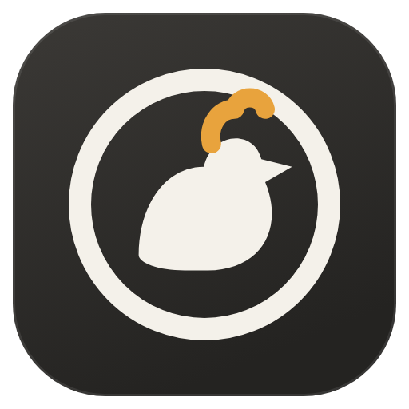

# Hen Browser

A lightweight browser on Microsoft Edge WebView2. Everything lives in a sidebar (tabs, address field, controls), with private tabs, built-in ad/tracker blocking, extensions straight from the Chrome Web Store, a download bar, and memory-saving tab sleeping. Needs the WebView2 runtime (part of Windows 11).

Part of [ChickenWM](https://github.com/despale-code/chickenwm), a Hyprland-style tiling desktop for
Windows. Each program lives in its own repository; the ChickenWM repository ties them together
and has the full documentation and the installer.

This project is vibecoded: written with an AI assistant.

## Building

Windows 10 or 11 (64-bit) and Rust 1.85 or newer:

```
cargo build --release
```

It depends on [chickenwm-core](https://github.com/despale-code/chickenwm-core), which Cargo fetches from GitHub.

## License

MIT, see [LICENSE](LICENSE).
